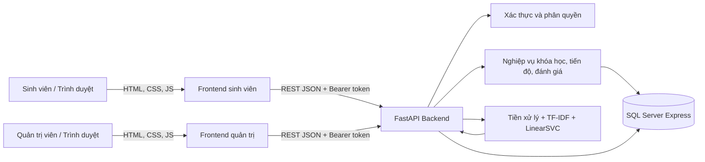
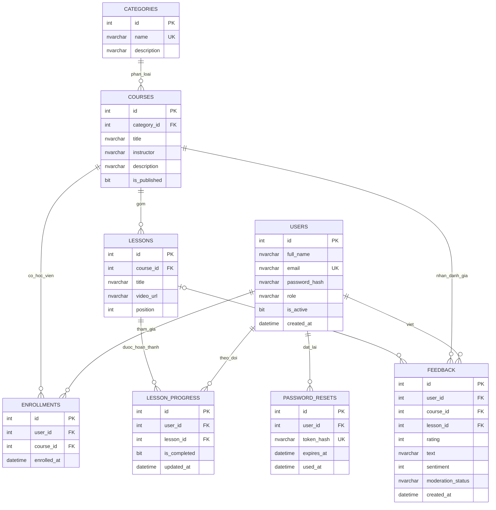
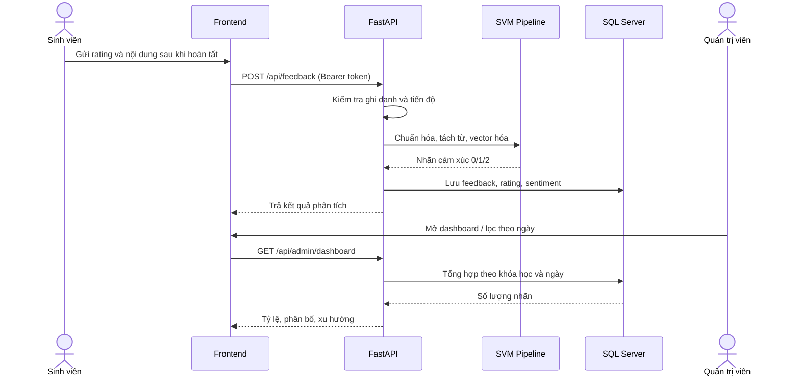

# Thiết kế hệ thống web EduPulse

## Phân chia Frontend / Backend

| Thành phần | Công nghệ và trách nhiệm |
|---|---|
| Frontend sinh viên | HTML, CSS, JavaScript trong `app/fe/index.html` và `app/fe/app.js`; tài khoản, danh mục/khóa học, video, tiến độ, đánh giá cá nhân |
| Frontend quản trị | `app/fe/admin.html` và `app/fe/admin.js`; dashboard, kiểm duyệt, danh mục/khóa học/bài giảng, tài khoản và phân quyền |
| Backend | FastAPI trong `app/be/webapp.py`; JSON REST API, xác thực, quyền, nghiệp vụ và gọi model |
| CSDL | SQL Server Express; ORM tại `app/be/web_models.py`; script cài đặt `data/sql/01_schema.sql` |
| Phân tích cảm xúc | `clean_text` → `underthesea` → vectorizer TF-IDF đã fit trên train → LinearSVC; nhãn 0/1/2 |

Frontend và backend được phục vụ cùng origin bởi FastAPI. Sinh viên và quản trị viên dùng hai trang tách biệt: `/` và `/admin`. API công khai tại `/api`; OpenAPI/Swagger tại `/docs`.

## Sơ đồ kiến trúc



## ERD



Một sinh viên chỉ có một đánh giá cấp khóa học và một đánh giá cho mỗi bài giảng. Khóa học được đánh giá sau khi hoàn tất tất cả bài; bài giảng được đánh giá sau khi đánh dấu hoàn thành. `sentiment`: 0 tiêu cực, 1 trung tính, 2 tích cực. `moderation_status`: `visible` hoặc `hidden`.

## Luồng gửi đánh giá và thống kê



## Nhóm API chính

| Nhóm | Endpoint tiêu biểu | Quyền |
|---|---|---|
| Tài khoản | `POST /api/auth/register`, `/login`, `/forgot-password`, `/reset-password`; `GET /api/auth/me`; `PATCH /api/auth/profile` | Công khai / sinh viên |
| Danh mục & khóa học | `GET /api/categories`, `GET /api/courses`, `GET /api/courses/{id}` | Công khai |
| Ghi danh & tiến độ | `POST /api/courses/{id}/enroll`; `GET /api/student/courses`; `PUT /api/student/lessons/{id}/progress` | Sinh viên |
| Đánh giá | `POST`, `PUT`, `DELETE /api/feedback`; `GET /api/student/feedback` | Sinh viên; chỉ chủ sở hữu sửa/xóa |
| Quản trị nội dung | `/api/admin/categories`, `/api/admin/courses`, `/api/admin/lessons` | Admin |
| Kiểm duyệt và người dùng | `/api/admin/feedback`, `/api/admin/users` | Admin |
| Dashboard | `GET /api/admin/dashboard?from_date=YYYY-MM-DD&to_date=YYYY-MM-DD` | Admin |

## Cài đặt SQL Server

1. Kết nối SSMS tới `BUIGIABAO\SQLEXPRESS` bằng Windows Authentication.
2. Chạy toàn bộ `data/sql/01_schema.sql`; file tạo database `ElearningSentiment`, bảng, index và danh mục mẫu.
3. Chạy `data/sql/02_seed_sample_data.sql` để thêm dữ liệu demo. Tài khoản quản trị `admin@demo.example.com` và sinh viên `student1@demo.example.com` dùng chung mật khẩu `Demo1234!`.
4. Sao chép `.env.example` thành `.env`. `DATABASE_URL` trong file mẫu đã dùng ODBC Driver 18, Windows Authentication và `TrustServerCertificate=yes` theo ảnh kết nối.
4. Đăng ký tài khoản sinh viên, rồi nâng quyền tài khoản đầu tiên trong SSMS:

   ```sql
   USE ElearningSentiment;
   UPDATE dbo.Users SET role = N'admin' WHERE email = N'admin@example.edu';
   ```

5. Cài Python dependencies, tạo artifacts TF-IDF/model bằng CLI và khởi động `uvicorn` theo README.

### Ghi chú vận hành

- Tiến độ video là thao tác đánh dấu hoàn thành do sinh viên xác nhận; bản hiện tại chưa đo thời lượng xem thực tế từ player.
- Đặt `SMTP_*` để gửi mã reset qua email. Khi `APP_ENV=development` và chưa cấu hình SMTP, endpoint trả token demo; production phải đổi `APP_SECRET_KEY` và đặt `APP_ENV=production`.
- Model và vectorizer là file cục bộ bị `.gitignore`; cần tạo chúng trên máy chạy ứng dụng. Khi một trong hai thay đổi, khởi động lại API để nạp cặp artifact mới.
- Nội dung phản hồi ẩn sẽ không xuất hiện trong dashboard và trang đánh giá công khai. Xóa phản hồi là xóa vĩnh viễn.
